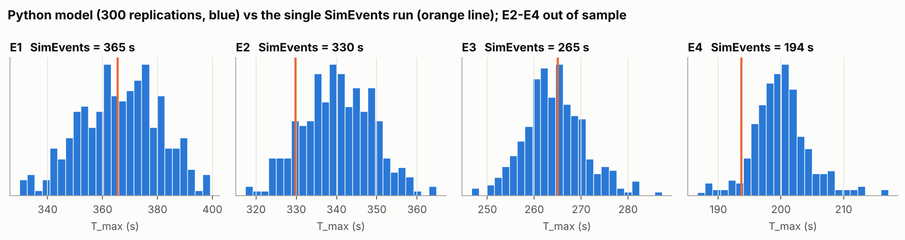
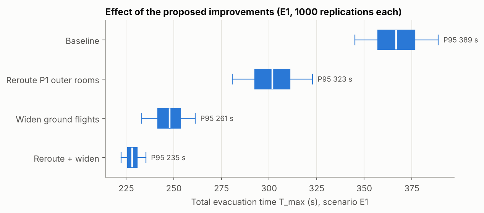
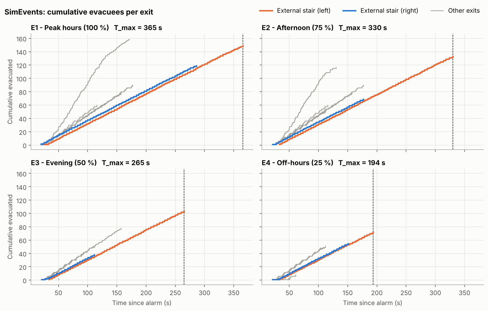
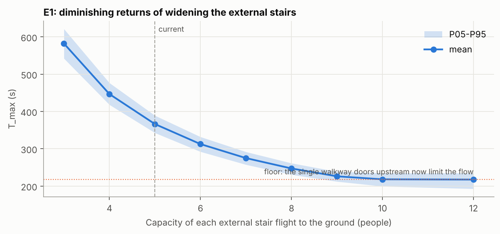

# Building Evacuation as a Queueing Network: Discrete-Event Simulation and Monte Carlo Risk Analysis

Discrete-event simulation (DES) of the emergency evacuation of a four-floor university building (Building G, Universidad Francisco de Vitoria, Madrid). The building is modelled as a **network of FIFO queues**: doors, corridors and stairs are servers with finite capacity, occupants are entities with random walking speeds and reaction times.

The project started as a team course project built in MATLAB/SimEvents. This repository contains an **independent Python (SimPy) re-implementation** that is validated against the original results and then extends them with what a single deterministic run cannot give: a **Monte Carlo distribution of the evacuation time**, its tail (P95), and a quantitative test of the improvements proposed in the original report.

## Key results

| Scenario | Occupants | Mean T_max | P95 T_max |
|---|---|---|---|
| E1 Peak hours (100 %) | ~820 | 367 s | 389 s |
| E2 Afternoon (75 %) | ~640 | 341 s | 354 s |
| E3 Evening (50 %) | ~360 | 265 s | 276 s |
| E4 Off-hours (25 %) | ~270 | 200 s | 208 s |

*1,000 replications per scenario. T_max = time until the last occupant leaves the building.*

- **Validation.** Three undocumented geometric parameters were calibrated on scenario E1 only (RMSE 5.2 s over the clearance times of the 8 exits). In all four scenarios, including the three out-of-sample ones, the original SimEvents result falls inside the Python model's 5-95 % band (E4 at its lower edge), and the mean evacuation time is within 3.2 % of it.
- **Bottleneck.** The left external stair to the ground determines T_max in every scenario, because it is the only route that merges the flows of two floors.
- **Improvements (E1, P95 of T_max).** Rerouting two first-floor classrooms to the interior stair: 389 s → 323 s (−17 %). Widening the external ground flights by ~60 %: → 261 s (−33 %). Both together: → 235 s (−39 %), at which point the critical exit moves inside the building.
- **Diminishing returns.** Widening the stairs beyond ~10 people per flight no longer helps: the single doors from the upper floors onto the walkway become the limit.

| Validation against SimEvents | Effect of the proposed improvements |
|---|---|
|  |  |
|  |  |

## Model

- **Occupants** (report, Table 5.1): five profiles (young/adult male and female, senior) with walking speed *v*, stair factor *α* and pre-movement time *t_pre ~ U(a, b)*; mix 40/40/8/8/4 %.
- **Elements**: each door, corridor or stair has a capacity *c* and a traversal time *t = d / (v·f)*, with *f = α* on stairs and 1 on flat elements. Throughput ≈ *c·v·f / d*.
- **Routes**: every room is assigned to an exit following the building's evacuation plan; people on open walkways join the nearest flow.
- **Scenarios** (report, Tables 5.2-5.3): four occupancy levels across the teaching day; open spaces (corridor tables, walkways, staff rooms) have random occupancy.
- **Calibration**: door length, landing-door length and external-stair length are fitted with Nelder-Mead on common random numbers (`evacuation.experiments.calibrate`).

## Repository structure

```
├── src/evacuation/
│   ├── config.py        # profiles, elements, routes, spaces, scenarios (all inputs, documented)
│   ├── model.py         # SimPy model: one process per occupant, one Resource per element
│   ├── experiments.py   # Monte Carlo, calibration, interventions
│   └── plots.py         # figure style
├── notebooks/
│   ├── 01_simevents_results_and_validation.ipynb
│   └── 02_monte_carlo_and_interventions.ipynb
├── data/simevents/      # exit times exported from the original SimEvents model (E1-E4)
├── results/             # tables produced by the notebooks
└── figures/
```

## How to run

```bash
git clone https://github.com/AsierLoz13/building-evacuation-des.git
cd building-evacuation-des
python -m venv .venv
# Windows: .venv\Scripts\activate    macOS/Linux: source .venv/bin/activate
pip install -r requirements.txt
pip install -e .        # makes `import evacuation` work anywhere
jupyter lab
```

Run the notebooks in order. Notebook 2 runs ~8,000 simulations and takes a few minutes.

Minimal example:

```python
from evacuation import simulate, monte_carlo, summarize_tmax, reroute_p1_mediums

run = simulate("E1", seed=42)            # one replication
print(run["t_max"])

mc = monte_carlo("E1", n_reps=500, building=reroute_p1_mediums())
print(summarize_tmax(mc["runs"]))        # mean, std, P05, median, P95, max
```

## Limitations

- Door and stair dimensions are calibrated to the original model, not measured on site.
- Occupants follow their assigned route; there is no individual interaction, overtaking or route switching (a standard DES simplification).
- Not validated against evacuation drills or fire-safety regulation. Results are best read comparatively (policy A vs policy B).

## Credits

Original course project (MATLAB/SimEvents model and report, 3rd year, Mathematical Engineering, UFV): Javier Fernández, Isabel del Peso, Marco Maqueda and Asier Lozano.

Python re-implementation, validation and Monte Carlo extension: [Asier Lozano Nebreda](https://www.linkedin.com/in/asier-lozano-nebreda/).

## References

- Fruin, J. J. (1971). *Pedestrian Planning and Design*. Metropolitan Association of Urban Designers and Environmental Planners.
- Lino, P., de Oliveira, E. C. and Teixeira, L. F. (2009). Modeling and Simulation of Crowd Egress Dynamics in a Discrete Event Environment. *IEEE International Conference on Control Applications*.
- Kuligowski, E. D. (2016). Modeling Human Behavior During Building Fires. *Risk Analysis*, 36(4), 741-754.
